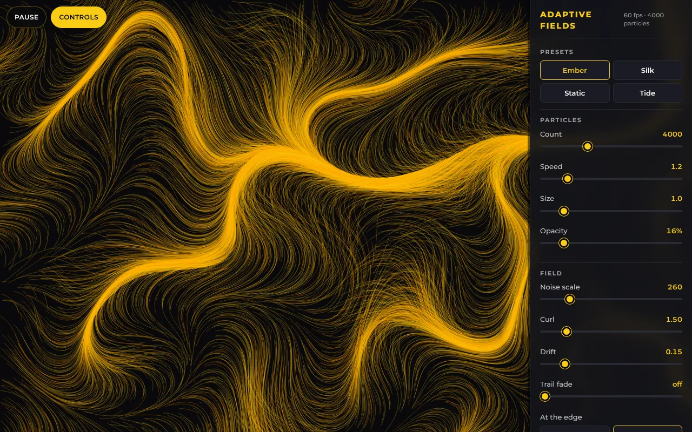

# Adaptive Fields

A flow field you can tune by hand. Thousands of particles follow a slowly
shifting noise field and leave light trails behind them. Change the field
while it runs, or drag across the canvas to stir it.

## Controls

| Control | What it does |
| --- | --- |
| Count, Speed, Size, Opacity | How many particles there are, how far each moves per frame, the stroke width and how strongly each stroke paints |
| Noise scale | The size of the field's features in pixels: small values give tight turbulence, large values long sweeping curves |
| Curl | How far the heading can turn across the field |
| Drift | How quickly the field itself changes over time |
| Trail fade | How fast old strokes disappear; `off` keeps painting forever |
| At the edge | Wrap particles to the other side, or start them again somewhere random |
| Colours | Ink, an optional second colour for half of the particles, and the ground |
| Presets | Ember, Silk, Static and Tide |
| Randomise / Reset | A random set of values, or back to the defaults |
| New seed, Clear, Save PNG | A different noise pattern, a blank canvas, or a download of the current picture |

Keys: <kbd>Space</kbd> pause, <kbd>H</kbd> show or hide the panel,
<kbd>R</kbd> randomise, <kbd>N</kbd> new seed, <kbd>C</kbd> clear,
<kbd>Esc</kbd> close the panel.

On a phone the panel is a bottom sheet behind the **Controls** button.
With reduced motion turned on in the system settings the page draws a still
picture and only animates after **Play**.

## How it works

`script.js` is plain Canvas 2D with no libraries. A seeded 3D gradient noise
(x, y and time) gives each point an angle; every particle steps along that
angle and the step is drawn as a short line. Particle positions live in typed
arrays and each colour is stroked as a single path per frame, which keeps
ten thousand particles at 60 fps on a laptop. The canvas follows the screen's
pixel ratio (up to 2x), keeps its picture through a resize and stops drawing
while the tab is hidden.

Typeface: Montserrat (SIL Open Font License, see `fonts/OFL.txt`).
