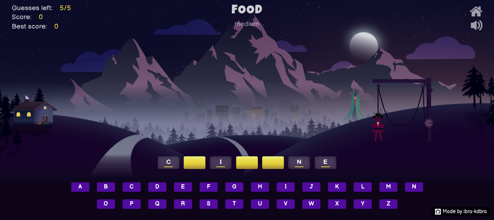

# Hangman

 

 

## About the project

Hangman is a word game in which one player has to guess a word that the other player (the computer in this case) has thought of, by guessing the letters in it. Every time the player guesses a wrong letter, the rope that's tightening the man will get pulled by a tiny bit, until it gets completely pulled and the man is hanged. The player has to make the right guesses before the rope gets completely pulled to win the game.

The game is responsive to different window sizes, built with HTML, CSS3, and vanilla javascript.

## How to play

- Pick a category (14 of them) and a difficulty, then guess letters by clicking/tapping them or typing on your keyboard.
- Every correct letter is worth 10 points. Five wrong guesses and the rope is pulled tight.
- Solve a word to move on (Enter, the arrow button, or swipe left on touch screens). Your score and words-in-a-row streak carry over until you lose.
- **Hint** (or the `?` key) reveals one hidden letter, once per word. It costs 15 points, or one guess when you can't afford it.
- **Daily word**: one puzzle per day, the same for everyone (seeded by the date). Solve it on consecutive days to build a daily streak.
- Best score and streaks are saved in your browser.

 

# Project Files Description

### **`index.html`**
The entry point of the project.

---

### **`main.js`**
The main JavaScript file that handles:
- Game logic, hints, the daily word and keyboard input.
- Animations.
- Loading the offline word lists from `data/words.json` (at least 60 family-friendly words per category).
- Optionally ("Online bonus words" in the menu, off by default) adding extra words from the [Datamuse](https://www.datamuse.com/api/) and [PokéAPI](https://pokeapi.co/) APIs. The game never depends on them.

---

### **`rope.js`**
This file contains the logic for all canvas animations used to calculate and display the hanging animation of a person. It implements a **simple particle system** to simulate the motion of a rope using physics.

#### **Key Features:**
- Utilizes **Hooke's Law** with a spring-damper system to simulate tension:
  \[
  F = -\beta v - kx
  \]
  Where:
  - **x**: Vector displacement from the spring's equilibrium position.
  - **k**: Spring constant (tightness of the spring).
  - **β**: Coefficient of damping.
  - **v**: Relative velocity between two points connected by the spring.

#### **Parameters:**
You can tweak the following parameters (declared at the beginning of the file) to achieve different animation effects:
- **Mass** of particles.
- **Density** of the rope.
- **Gravity** acting on the system.
- Spring constants (**k**, **β**) and initial displacement (**x**).

---

### **`loader.js`**
Handles the loading animation while preloading all media assets (images and sounds) with plain `Image`/`Audio` objects. Each asset has a timeout, and a missing file never blocks the game.

---

### **`parallax.js`**
A small pointer / device-tilt parallax for the layered background (replaces Parallax.js). It is disabled when the system asks for reduced motion.

---

### **`libs/gsap-3.12.6.min.js`**
[GSAP](https://gsap.com) 3.12.6, vendored. Subject to the [GSAP standard license](https://gsap.com/standard-license).

--- 

This layout ensures modularity and efficiency for handling animations, logic, and asset loading in the project.

