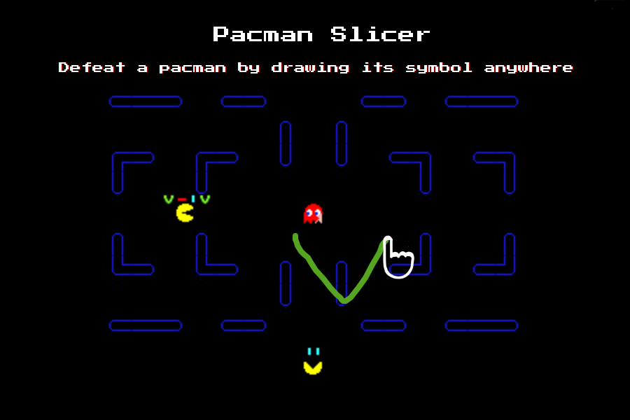

# PacMan Slasher

HTML5 game inspired by Pac-Man, with a twist: you draw to fight.

## Gameplay

Pac-Men walk in from the edges towards your ghost, each carrying a row of
symbols. Draw a symbol anywhere on screen to strike it off every Pac-Man whose
next symbol matches; clear a whole row to slash that Pac-Man.

- **Waves**: each wave adds one new thing, announced before it starts:
  `—` and `|`, then `V`, `Λ`, sprinters (fast, short rows), `/`, `\`,
  brutes (slow, long rows) and finally `O`. From wave 10 everything moves faster.
- **Combo**: every correct symbol raises the score multiplier (up to x7.5);
  a wrong symbol or a hit resets it.
- **Fruit**: draw the lightning bolt on a cherry to clear the screen, on an
  apple to freeze every Pac-Man.
- Clearing a wave restores a lost life, or doubles the wave bonus at full health.

`P` or `Esc` pauses, `M` mutes. The game pauses itself when the tab is hidden.

Sound: [howler.js](https://howlerjs.com) 2.2.4, vendored in `js/vendor/` (MIT license alongside).
