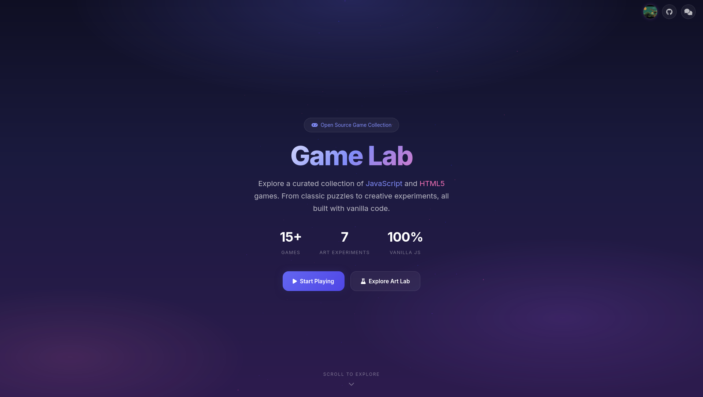

# JavaScript Game Collection



<div style="text-align: center;">
  <a href="LICENSE">
    
  </a>
  <a href="https://github.com/ibra-kdbra/JS_game_collections/graphs/contributors">
    
  </a>
  <a href="https://github.com/ibra-kdbra/JS_game_collections/stargazers" target="_blank">
    
  </a>
  <a href="https://github.com/ibra-kdbra/JS_game_collections/network/members" target="_blank">
    
  </a>
  <a href="https://jsgamelab.ibrakdbra.me/" target="_blank">
    
  </a>
</div>

**Play it here: [jsgamelab.ibrakdbra.me](https://jsgamelab.ibrakdbra.me/)**

<details>
<summary>Table of Contents</summary>

- [JavaScript Game Collection](#javascript-game-collection)
  - [Overview](#overview)
  - [The Games](#the-games)
  - [Art Lab](#art-lab)
  - [Why Plain JavaScript and the Canvas?](#why-plain-javascript-and-the-canvas)
  - [Licence](#licence)
  - [Getting Started](#getting-started)
  - [Checks](#checks)
  - [Game Development Process](#game-development-process)
</details>

## Overview

A collection of 21 browser games and 8 visual experiments, written in plain **JavaScript**,
**HTML5** and **CSS3**: no framework and no build step. Every page is a static file you can
open from any web server. Every game works on phones (touch controls, phone-sized
layouts) as well as with a keyboard and mouse.

A few games use a small library where it does real work: three.js for the 3D games, p5.js for
Tower Defense, Howler for one game's sound. They are kept in the repository, so nothing is
loaded from a CDN and the site works the same everywhere.

## The Games

| Game | Genre | What it is |
|---|---|---|
| [Tower Defense](https://jsgamelab.ibrakdbra.me/TowerDefense/index.html) | Strategy | 30-wave campaigns and an endless mode on 18 maps, 7 towers that upgrade, bosses. Plays in a lit 3D view (models built in code to match the 2D art, animated on the GPU) or the classic flat view; a 3D/2D button switches. |
| [Brainy Warrior 3D](https://jsgamelab.ibrakdbra.me/Brainy_Warrior/index.html) | Puzzle | Slide your warrior into every enemy without falling into the sea, and move the wizard to make your own walls. 34 levels on a 3D island, each with a solver-proven par. |
| [Volt Flip](https://jsgamelab.ibrakdbra.me/Volt_Flip/index.html) | Arcade | A one-button runner: flip gravity between floor and ceiling. Endless, Overdrive and daily runs through five city sectors, plus a 30-level story campaign. |
| [2048 with AI](https://jsgamelab.ibrakdbra.me/2048/index.html) | Puzzle | The tile-merging puzzle with a built-in AI player. |
| [Crate Lab](https://jsgamelab.ibrakdbra.me/Sokoban/index.html) | Puzzle | Sokoban-style crate pushing across 40 original levels with solver-proven pars. |
| [Minesweeper](https://jsgamelab.ibrakdbra.me/Minesweeper/index.html) | Puzzle | Every board solvable by logic, with a daily board, a puzzle ladder, hints and stats. |
| [Gravity Wells](https://jsgamelab.ibrakdbra.me/Gravity_Wells/index.html) | Puzzle | A space puzzle game of 25 puzzles, each solvable within its move limit. |
| [ReWire](https://jsgamelab.ibrakdbra.me/ReWire/index.html) | Puzzle | Drag the cable around the power nodes and plug it in. 22 levels. |
| [Hangman](https://jsgamelab.ibrakdbra.me/Hangman/index.html) | Puzzle | Classic word guessing with word categories and options. |
| [Tetris](https://jsgamelab.ibrakdbra.me/Tetris/index.html) | Puzzle | The block-stacking classic: Sprint, Marathon, Ultra, Dig Race, Zen and two hard modes (Survival with rising garbage, Master at instant gravity), T-spin and combo scoring, five animated themes, touch controls and replays. |
| [Breakout](https://jsgamelab.ibrakdbra.me/Breakout/index.html) | Arcade | Brick breaker with 27 levels, special bricks, six power-ups and an endless mode. |
| [Snake](https://jsgamelab.ibrakdbra.me/Snake/index.html) | Arcade | Classic, Wrap, Zen and daily modes, plus 20 arenas with portals. |
| [PacMan](https://jsgamelab.ibrakdbra.me/PacMan/index.html) | Arcade | The arcade classic, with modes and playgrounds. |
| [PacMan Slasher](https://jsgamelab.ibrakdbra.me/PacMan_Slasher/index.html) | Arcade | Defeat each pacman by drawing its symbol anywhere on screen. |
| [Tron](https://jsgamelab.ibrakdbra.me/Tron/index.html) | Arcade | Light-cycle duels against an AI opponent. |
| [MoonLDR](https://jsgamelab.ibrakdbra.me/MoonLDR/index.html) | Arcade | Land the ship gently, in the spirit of Lunar Lander. |
| [Raven](https://jsgamelab.ibrakdbra.me/Raven/index.html) | Action | Fix a security system while enemies attack only when you aren't looking. 13 levels. |
| [Souls Bumper](https://jsgamelab.ibrakdbra.me/Souls-Bumper/index.html) | Action | A platformer through 14 challenging levels. |
| [HuggersFight](https://jsgamelab.ibrakdbra.me/HuggersFight/index.html) | Action | Fight the empire's outposts on remote planets. |
| [InterLaced](https://jsgamelab.ibrakdbra.me/InterLaced/index.html) | Strategy | A tactical network intrusion and sabotage simulator. |
| [Wahdatio](https://jsgamelab.ibrakdbra.me/Wahdatio/index.html) | Strategy | A 3D strategy game about unity and connection. |

[Back to top](#javascript-game-collection)

## Art Lab

Visual experiments, on the hub's [Art Lab](https://jsgamelab.ibrakdbra.me/Art_Lab/index.html)
page: Blossoming Flowers (pure CSS), Flow Fields, Text Fields, Experimental Math, Adaptive
Fields, LSD, Particular Drift, and Sprite Lab (eight sprite and game-loop lessons from
Franks Laboratory).

## Why Plain JavaScript and the Canvas?

1. **Understanding the platform**: building games on the browser's own APIs (canvas, WebGL,
   Web Audio, pointer events) without a framework teaches how they really work.
2. **Performance**: no framework layer between the game loop and the screen, and only the
   code each game needs.
3. **Complete control**: every system (loops, input, collisions, rendering, sound) is written
   for the game it serves, and can be tuned for it.

## Licence

The repository is under the [MIT licence](LICENSE), except two folders that keep the licence of the project they came from:

- `PacMan/`: GPL-3.0 ([`PacMan/LICENSE`](PacMan/LICENSE))
- `HuggersFight/`: GPL-3.0 ([`HuggersFight/LICENSE`](HuggersFight/LICENSE)); its engine in `HuggersFight/engine/` is LittleJS, MIT

[CREDITS.md](CREDITS.md) lists the original author and licence of every forked game, model, sound, library and font.

## Getting Started

To explore and run the games in this collection:

1. **Clone the repository**:
   ```bash
   git clone https://github.com/ibra-kdbra/JS_game_collections.git
   ```

2. **Go to the project directory**:
   ```bash
   cd JS_game_collections
   ```
3. **Serve it locally:** the hub and the 3D games use ES modules, which browsers won't load
   from `file://`. Any static server works:
   ```bash
   python3 -m http.server 8000
   ```
   Then open http://localhost:8000.

### Adding or editing a game on the hub

The hub and the Art Lab page are generated from one registry, `assets/js/data.js`.

1. Add an entry to `games` (or `experiments`) with its `slug`, `title`, `href`, `blurb`,
   `genre`, `inputs` and `mobile` flag. Set `mobile: true` only after checking the game at
   phone size with touch.
2. Add a 16:10 thumbnail as `assets/thumbs/<slug>-480.webp` and `<slug>-960.webp`.
3. Re-render the pages so the list works without JavaScript:
   ```bash
   node tools/render-pages.mjs
   ```
   `node tools/render-pages.mjs --check` exits non-zero if the pages are stale.

See [docs/UPGRADE_PLAN.md](docs/UPGRADE_PLAN.md) for the roadmap and [CREDITS.md](CREDITS.md) for
the original authors and licences of the games, models, sounds and libraries.

[Back to top](#javascript-game-collection)

## Checks

Every pull request and every push to `main` runs the checks in
[`.github/workflows/smoke.yml`](.github/workflows/smoke.yml), in parallel jobs:

- **Level checks**: each puzzle and level game has a solver or bot that proves every level
  can be won (Brainy Warrior, Crate Lab, Breakout, Snake, Volt Flip, Minesweeper, Souls Bumper,
  Gravity Wells, ReWire, Raven, Tower Defense maps), and the hub pages must match `data.js`.
  `node tools/render-pages.mjs` also sets the service worker's cache version from a hash of the
  hub files, so a changed hub reaches returning visitors; CI fails if the version is stale.
- **Browser smoke test**: `node tools/smoke.mjs` opens every page at phone and desktop size in
  Chromium and fails on any script error or missing file. A second job runs the same test in
  WebKit, Safari's engine (`node tools/smoke.mjs --engine webkit`).
- **Tetris**: `node Tetris/tools/verify-replays.mjs` plays 19 seeded games across every mode and
  handling setting and checks each replay ends exactly like its game, and
  `node Tetris/tools/verify-dig-race.mjs` checks a Dig Race ends once its garbage is cleared, in any order.
- **Tower Defense**: `node TowerDefense/tools/test-3d.mjs` checks the 3D view (load time, model
  size, draw-call budget, no stalls mid-battle, fallback to Flat), and
  `node TowerDefense/tools/aim-test.mjs` clicks towers during heavy explosions.
- **Gameplay checks**: the other games are played by a script or bot, so a change that breaks
  the core loop fails. `node Tron/tools/verify.mjs` (no browser) plays the AI against itself on
  every arena. `node tools/play-checks.mjs` runs the browser ones, each also runnable on its own
  as `node <Game>/tools/verify-play.mjs`:
  - 2048: 300 random moves checked against the slide-and-merge rules, an AI hint, Watch AI.
  - Hangman: wins a word and loses one with the built-in word list, offline.
  - HuggersFight: level 1's core loop: move, jump, shoot, kill an enemy, lose a life to a
    grenade, Game Over and restart.
  - InterLaced: from the terminal into story mesh 1, crashes nodes until it goes offline.
  - MoonLDR: an autopilot lands on flat pads three rounds in a row; no input crashes.
  - PacMan: the maze loads, the ghosts move, a bot eats 120 dots without dying.
  - PacMan Slasher: every symbol drawn with the mouse is recognised; a bot clears wave 1.
  - Tetris: a seeded Sprint played with the keyboard clears 40 lines.
  - Wahdatio: a mouse-driven bot wins level 1 and EASY.

The browser checks need Playwright (`npm install --no-save playwright`, then
`npx playwright install chromium`, plus `webkit` for the WebKit run). The Playwright version CI
uses is set once, as `PLAYWRIGHT_VERSION` at the top of the workflow, and the browsers are cached
between runs. The workflow file lists the command for every check, to run any of them locally.

[Back to top](#javascript-game-collection)

## Game Development Process

Each game in this collection is developed following a structured approach:

1. **Concept and design**: define the game's mechanics, objectives and controls, and sketch
   its layout and flow.

2. **Project setup**: a clean folder per game with separate HTML, CSS and JavaScript,
   semantic HTML5 elements and organised assets.

3. **Game logic**: algorithms and data structures for game state, input and rules.

4. **Rendering**, on the canvas, in WebGL, or with plain DOM and CSS art:
   - Drawing shapes and images with the canvas API, or 3D models with three.js.
   - Animating game objects with a fixed-step game loop and animation frames.
   - Collision detection between game entities.
   - The pattern that best fits each game.

   For a guide to the canvas element, see the [MDN Web Docs on the Canvas API](https://developer.mozilla.org/en-US/docs/Web/API/Canvas_API).

5. **Styling with plain CSS**:
   - Responsive layouts for phones and desktops, portrait and landscape.
   - A theme for each game's concept.
   - Animations and transitions for feedback.

6. **Testing and optimisation**: a solver or bot proves the levels can be won, the smoke test
   opens every page on phone and desktop, and code and assets are kept small so games run
   smoothly on modest devices.

[Back to top](#javascript-game-collection)
