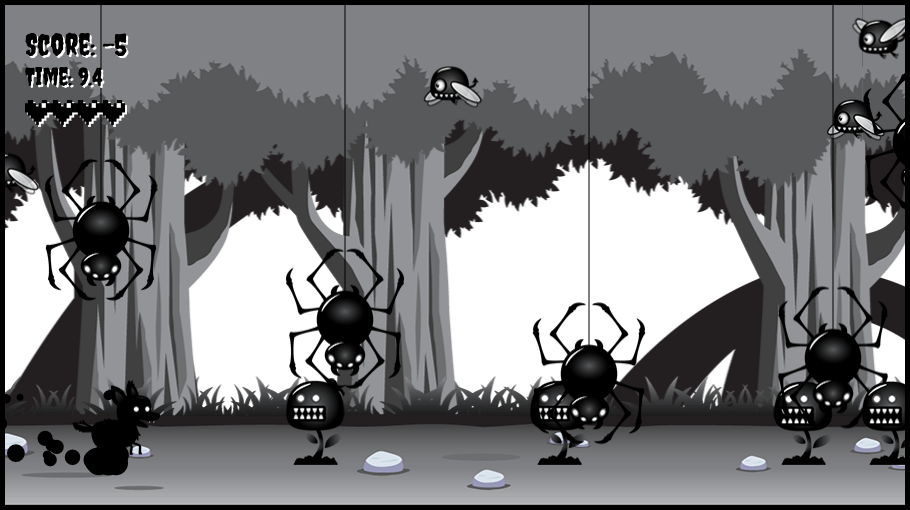

# Shadow Dog Runner

A side-scrolling canvas runner. The shadow dog runs through a haunted forest; rolling (or diving) through the creatures of the night scores points, touching them any other way costs a life.

## Modes

- **Classic**: score 40 points within 30 seconds. You have 5 lives.
- **Endless**: no timer. Enemies spawn faster over the first two minutes; play until your lives run out.

Personal bests for both modes are saved in the browser.

## Controls

| Action | Keyboard | Touch |
| --- | --- | --- |
| Run | Left / Right arrows, A / D | D-pad left / right |
| Jump | Up arrow, W | D-pad up |
| Sit, dive in the air | Down arrow, S | D-pad down |
| Roll (attack) | Hold Enter or Space | Hold **Roll** |
| Pause | P or Esc | **Pause** |
| Restart | R (paused or game over) | **Play again** |

The game pauses itself when the tab is hidden or the window loses focus.

## Code

Plain ES modules, no build step. `main.js` owns the game and the menus and runs the simulation on the Game Lab kit's fixed 60 steps-per-second loop, so speed is the same on 60 Hz and 120 Hz screens. The player is a state machine (`playerState.js`); `input.js` maps keys to actions and the kit's on-screen controls send the same keys.

## Credits

Built by following the "JavaScript Game Development" course by **Frank's Laboratory**, whose final project this game is based on, including its sprite sheets and forest background art: <https://www.youtube.com/@Frankslaboratory>.
