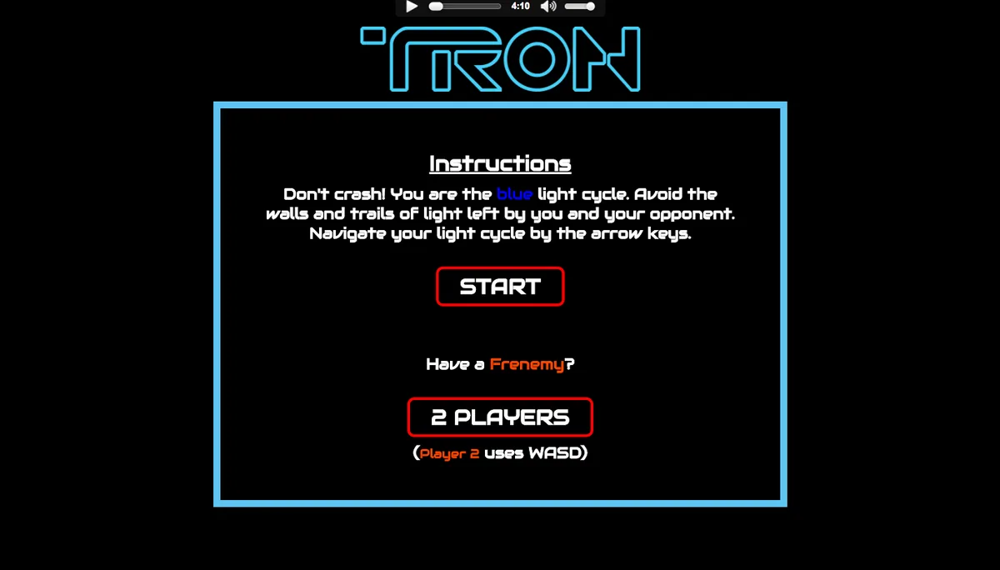
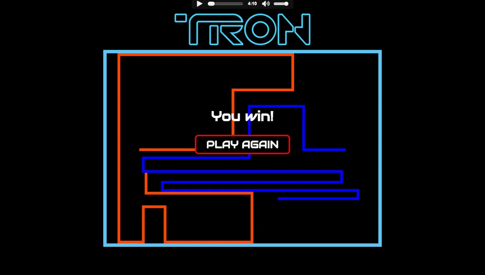

# Tron

Remake of the classic arcade game: steer a light cycle around the arena and make your opponent crash into a wall or a trail of light first. Play against the computer or a friend on the same keyboard.

## How to play

- **Blue**: arrow keys (or swipe / the on-screen pad on phones). Boost with Space, Enter or Right Shift.
- **Orange** (2 players): WASD, boost with Q or Left Shift.
- **P** or **Esc** pauses. Rounds start after a 3-2-1 countdown.
- Boost makes your cycle 75% faster while held. The meter drains in about a second and refills over five.
- If both cycles crash on the same step (for example head-on), the round is a draw.

Before each match pick the mode, computer difficulty, arena size (small, medium, large), an obstacle layout (none, pillars, gates, bars) and a single round or best of 5. On a portrait phone screen the arena is turned upright so it fills the display.

Wins, losses and your best win streak against each computer difficulty are saved in the browser.

## Architecture

Plain ES modules, no dependencies.

- `board.js`: the arena as a flat `Uint8Array` of cells (empty, blue, orange, wall), obstacle layouts, and a flood fill that counts reachable space.
- `bike.js`: a light cycle, its buffered turns, boost energy and the computer's decisions.
- `round.js`: advances one round in fixed time steps. Cycles move one cell at a time in lockstep, so a boosted cycle can't jump over a trail, and two cycles entering the same cell both crash.
- `view.js`: canvas renderer. Trails are painted into an offscreen layer as cycles move, so a frame costs a couple of image copies.
- `audio.js`: the soundtrack and effects, synthesised with the Web Audio API.
- `main.js`: menus, match flow, input and saving, built on the shared Game Lab kit (`assets/kit`).

## Computer opponent

At each decision the computer compares going straight, left and right by flood-filling the space each move leads to, and picks the roomiest. Difficulty controls how often it re-plans, how far ahead it looks, how much space it can count, how often it wanders and how eagerly it boosts. The hard computer also leans towards you to cut you off.
