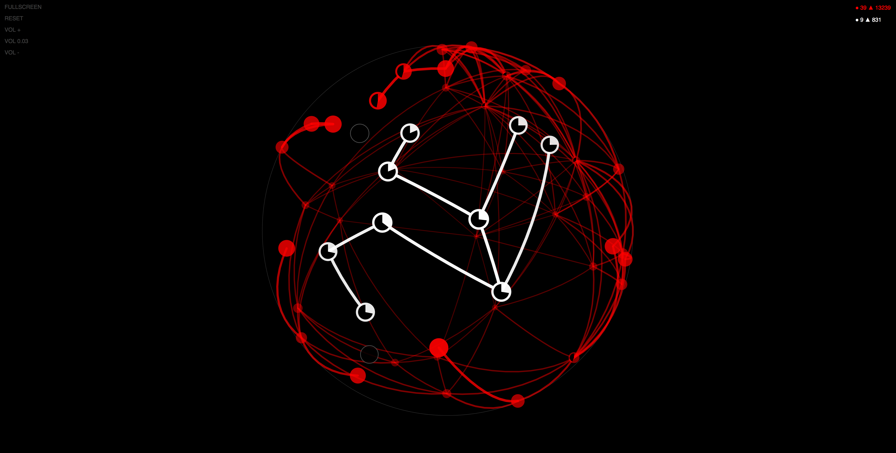
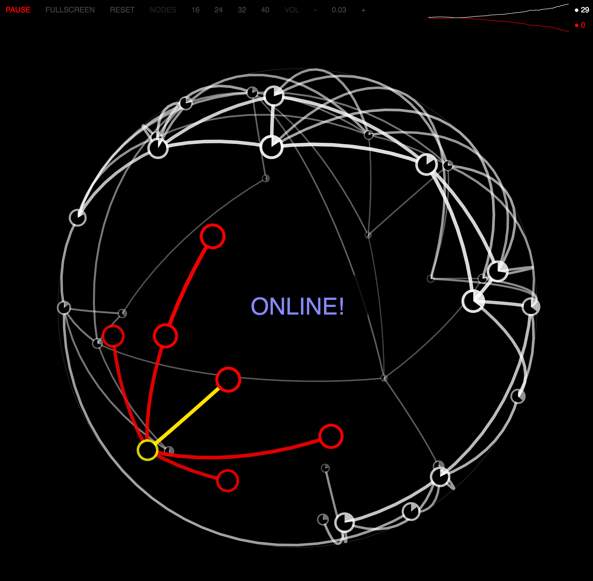
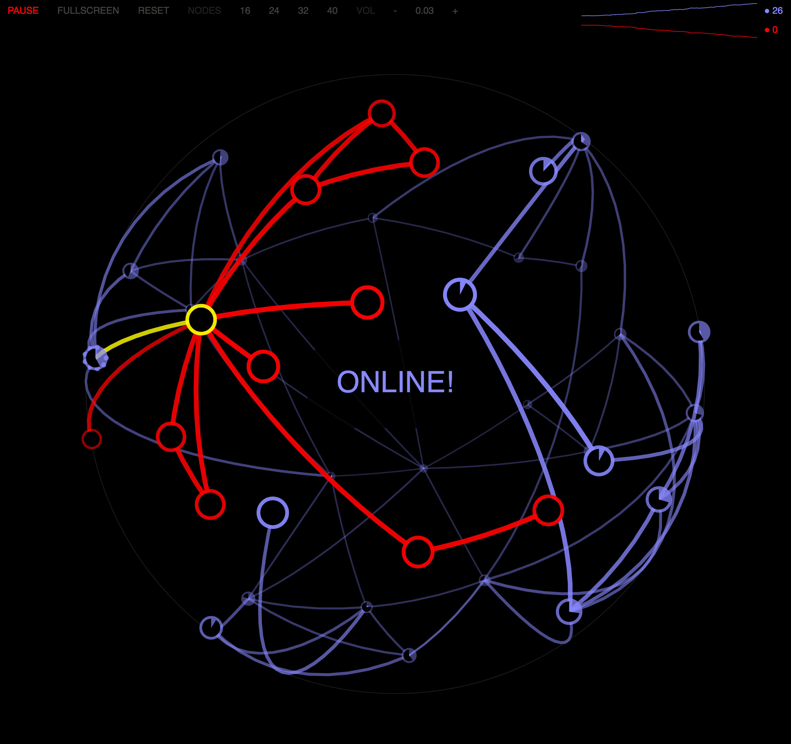
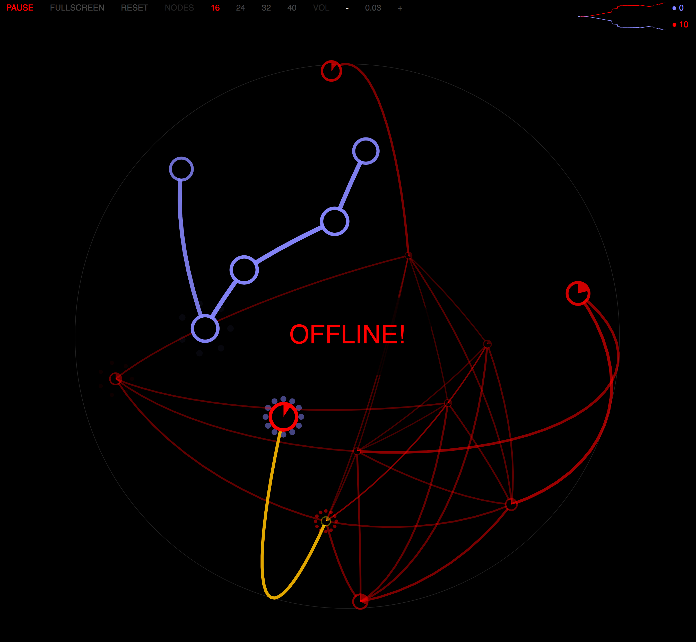
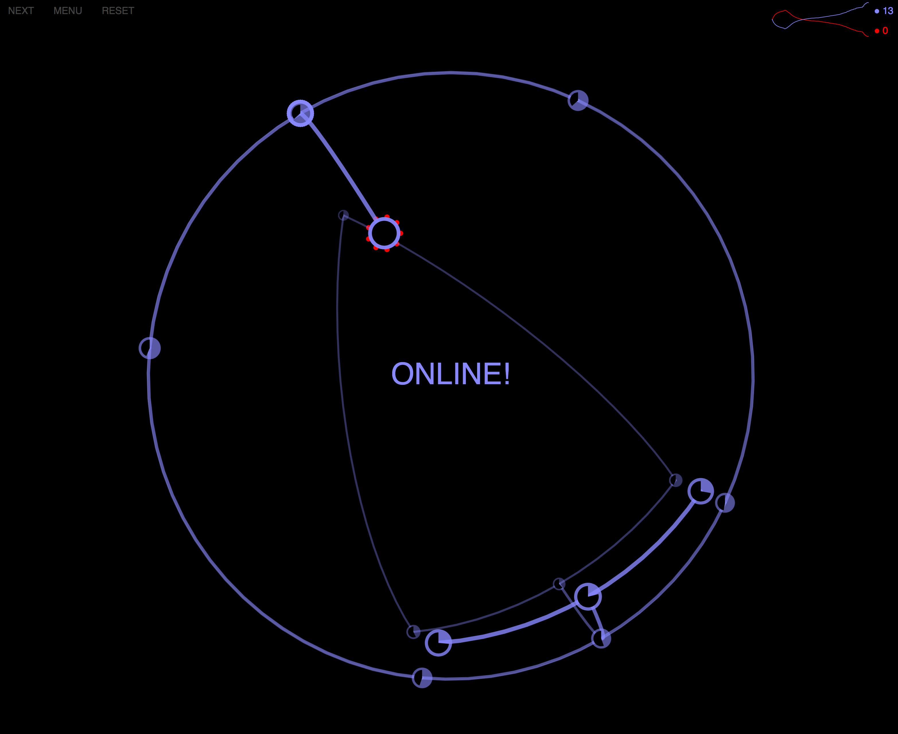
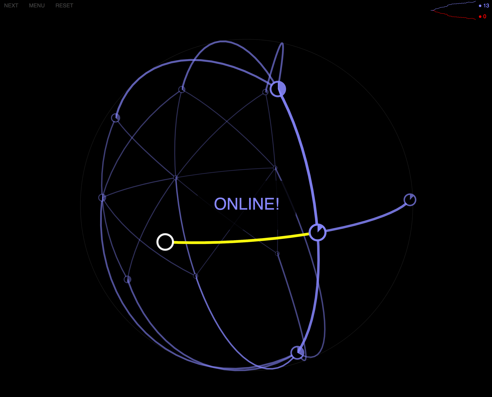

# Wahdatio - The State of Unity

## Overview

**Wahdatio** is a profound 3D strategy game that embodies the concept of unity and interconnectedness. The name draws from Arabic "Wahdat" (وَحْدَة) meaning "unity" or "oneness" - a fundamental concept in Islamic and Sufi philosophy - combined with the Latin "-tio" suffix denoting a state of being.

## Gameplay

Wahdatio is a strategic battle game played on the surface of a 3D sphere where players control nodes (dots) to fight against an AI opponent in a virus-themed battle for control.

### Core Mechanics

- **3D Spherical Battlefield**: Navigate and interact with nodes positioned on a rotating sphere
- **Node Control**: Capture and control nodes by sending "processes" between them
- **Strategic Combat**: Attack enemy nodes while defending your own territory
- **Resource Management**: Balance unit distribution across your network
- **Dynamic Audio**: Procedurally generated sound effects using Web Audio API

### Game Features

- **Multiple Levels**: From tutorial missions to challenging scenarios
- **AI Opponent**: Intelligent bot that adapts its strategy
- **Visual Effects**: Spark animations for attacks and interactions
- **Real-time Strategy**: Fast-paced decision making and resource allocation
- **Immersive Audio**: Custom synthesized musical instruments and sound effects

## Technical Implementation

- **Pure JavaScript**: No external frameworks or libraries
- **SVG Graphics**: Vector-based 3D-like rendering on 2D canvas
- **Web Audio API**: Procedural audio generation
- **Quaternion Mathematics**: 3D rotations and spatial calculations
- **Modular Architecture**: Organized class-based structure

## Game Gallery

### Screenshots

|  |  |
|:---:|:---:|
|  |  |
|  |  |

## Philosophy

The game's name and mechanics reflect the philosophical concept of "Wahdat al-Wujud" (Unity of Being) - the idea that all existence is interconnected and unified at its core. Players must achieve strategic unity across their network while disrupting the opponent's cohesion.

## How to Play

1. **Rotation**: Drag anywhere on the sphere (mouse or one finger) to rotate the view
2. **Attack**: Drag from one of your blue nodes to another node to send half of its processes
3. **Strategy**: Manage your resources and capture territory strategically
4. **Victory**: Deactivate all red nodes to win

## Controls

- **Mouse / touch drag** on empty space: rotate the sphere
- **Drag from your node**: send processes (on touch screens you can start a little beside a node)
- **Space / Escape**: pause
- **R**: restart the current level
- **OPTIONS > BOT**: bot difficulty (EASY, NORMAL, HARD). It scales how long the bot waits between moves.

Won levels, volume and difficulty are saved in the browser (Game Lab storage). Progress from earlier versions, which used IndexedDB, is copied over automatically the first time the game loads.

## Development

The game is built using vanilla JavaScript with advanced mathematical concepts including:
- 3D vector mathematics
- Quaternion rotations
- Procedural audio synthesis
- Real-time graphics rendering

### Source of truth

`script.js` is the source of truth and is edited directly; there is no build step.

The original CoffeeScript sources are kept in `src/` for the record only. `script.js` was regenerated from them once with CoffeeScript 2.7.0 (all files joined in this order and compiled as one unit: vec, quat, pref, synt, snd, glob, sprk, line, dot, grph, bot, menu, lvls, load, main), after fixing a stray quote in `menu.coffee`. Everything since then (touch input, time-based unit growth, bot difficulty, storage) exists only in `script.js`.

---

*"In the unity of existence, every connection matters, every node counts."*
